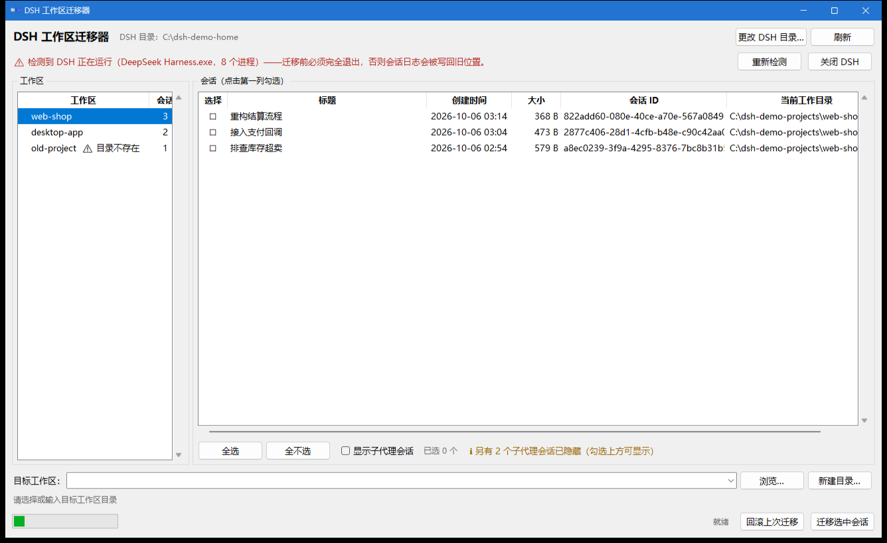

# DSH 工作区迁移器

把 DeepSeek Harness 的会话**原地迁移**到另一个工作区，对话上下文逐字节保留。

> Move a DeepSeek Harness session to another workspace, in place, with the conversation
> history preserved byte-for-byte.



（截图用的是本项目自带的合成数据，不含任何真实会话。）

## 它解决什么问题

DSH 把会话和「它在哪个工作区」绑在一起。当你把一个项目文件夹改名或搬家之后，
旧会话就留在了旧路径上 —— 在 DSH 里要么显示不出来，要么打开后所有相对路径都错位。

DSH 本身没有「换个工作区」这个操作：工作区归属是从会话自带的 cwd 推导出来的，
界面上也没有对应按钮。这个工具补上了这件事：**同一个会话、同一个 session id、
同一份日志，只把它的工作目录改到新位置。**

## 特性

- **原地迁移**，不是「导出再导入」：session id、日志文件、事件流都保持原样
- **上下文零改动**：只重写日志的第 0 个 zstd 帧（header），之后的字节逐字节搬运
- **可视化**：列出工作区与会话，勾选即迁；子代理会话默认隐藏（DSH 侧边栏也不显示它们）
- **自动备份 + 一键回滚**：每次迁移前整份备份，出问题可还原到迁移前
- **迁移前自检**：DSH 是否还在运行、程序有没有写权限、目标目录是否有效
- **失败说人话**：权限、占用、路径问题都会给出「原因 + 下一步怎么办」
- **无人值守模式**：可以先挂一个等待进程，关掉 DSH 后自动完成迁移

## 快速开始

### 方式一：用打包好的程序（Windows）

解压 `DSH会话迁移-vX.Y.zip` 到**工作区之外**的任意目录（原因见下方「注意」），
双击 `DSH工作区迁移器.exe`。

首次运行 Windows SmartScreen 会提示「未知发布者」（因为没有代码签名），
点「更多信息 → 仍要运行」即可。

### 方式二：从源码运行

```powershell
git clone <this-repo>
cd <this-repo>
python -m venv .venv
.\.venv\Scripts\python.exe -m pip install zstandard
.\.venv\Scripts\python.exe run.py            # 启动界面
```

打包成 exe 需要额外安装 PyInstaller：

```powershell
.\.venv\Scripts\python.exe -m pip install pyinstaller
powershell -ExecutionPolicy Bypass -File tools\build.ps1
```

## 用法

### 图形界面

1. 左侧选工作区，右侧勾选要迁移的会话（点第一列的方框）
2. 下面选或填目标工作区目录（可点「浏览…」/「新建目录…」）
3. 点「迁移选中会话」→ 确认

迁移完成后重新打开 DSH，新工作区里就能看到这些会话。

顶部横幅会实时检测 DSH 进程；检测到在运行时会直接拒绝迁移（见下方「注意」）。
如果 DSH 目录不在默认位置，点「更改 DSH 目录…」指定。

### 命令行

```powershell
python run.py --list                                    # 列出工作区与会话
python run.py --migrate <会话id> [<会话id>...] --to <目标目录>
python run.py --rollback [备份目录]                      # 回滚（默认最近一次）
python run.py --selftest                                # 在合成数据上跑端到端自检
```

DSH 目录按 `DSH_HOME` → `~/.dsh` → 常见安装目录 的顺序自动探测，也可用 `--home` 指定。

### 无人值守

适合「人不在，但希望关掉 DSH 后自动完成迁移」：

```powershell
# 1) 复制配置模板并填写
copy tools\auto-migrate-config.example.json tools\auto-migrate-config.json

# 2) 预演（不写任何东西）
python tools\auto_migrate.py --config tools\auto-migrate-config.json --now --dry-run

# 3) 挂上等待进程：等 DSH 完全退出（并稳定约 6 秒）后自动迁移，然后写日志退出
pythonw tools\auto_migrate.py --config tools\auto-migrate-config.json

# 取消等待
powershell -ExecutionPolicy Bypass -File tools\cancel-auto-migrate.ps1
```

> 注意：直接用上面的方式启动，等待进程是 DSH 的子进程，DSH 退出时会被一起带走。
> 要让它活过 DSH 退出，得由别的宿主拉起 —— 例如计划任务，或用 WMI
> `Win32_Process.Create`（父进程会成为 `WmiPrvSE.exe`）。

## 它到底改了什么

DSH 里「会话属于哪个工作区」不是某个字段，而是三处共同推导出来的，必须一次改齐：

| # | 位置 | 改动 | 不改会怎样 |
|---|------|------|-----------|
| 1 | 日志第 0 个 zstd 帧里的 `header.cwd` | 改成新目录 | 打开会话时 DSH 会校验「实际路径 == 由 header 推导的路径」，不一致直接报 `corrupt session log` |
| 2 | 日志所在目录 `sessions/<projectKey(cwd)>/<id>/` | 移到新的 `projectKey` | 目录名本身就是由 cwd 编码出来的，必须同步 |
| 3 | `storages/workspace.json` | 会话从原工作区注销、登记到目标工作区 | 归属判定是 `realpath(header.cwd) === record.path`；`initialized: true` 时启动**不会**重新 bootstrap，所以必须手工改表 |
| 4 | `storages/session_projcache/sessions/<id>.json` | 把缓存身份里的 `cwd` 改指新目录 | 缓存身份包含 cwd，失配即作废。删掉也能用（DSH 会重建），但标题等缓存行会短暂丢失 |
| 5 | `usage-stats/index-v1.json` | 该会话的 `cwd` 改成新目录 | 用量面板按 cwd 归类，会一直显示旧目录 |

关键点：DSH 的会话日志是**多帧 zstd** —— 第 0 帧是 header，之后每帧是一批事件。
迁移器只重写第 0 帧，**第 0 帧之后的字节原样复制**，所以事件流零改动，上下文不可能被破坏。

引擎里逐字符复刻了 DSH 的 `projectKey()` / `encodeSegment()` / `scanZstdFrames()`，
并用 `write_checksum=True, write_content_size=False` 产出与 DSH 同形的 zstd 帧。

## 安全

- **整份备份**：每次迁移前把会话目录 + `workspace.json` + 投影缓存 + usage-stats
  复制到 `<DSH_HOME>/migration-backups/gui-<时间戳>/`，并写 `manifest.json`
- **写前自检**：先写临时文件、读回校验（帧数、`cwd`、`id`）通过后才原子替换
- **一键回滚**：按 manifest 还原，日志逐字节复原
- **运行状态拦截**：检测到 DSH 进程时拒绝迁移。运行中的会话会往**旧路径**再写日志，
  导致同一个 session id 出现在两个目录里，DSH 启动时会直接报 duplicate 错误
- **长路径安全**：会话日志路径很容易超过 Windows 的 `MAX_PATH(260)`
  （`DSH_HOME` + 最长 255 的 projectKey 段 + 44 的 id 段），所有文件操作统一走 `\\?\` 前缀
- **不是跨文件事务**：极端情况（断电等）可能只完成一部分，用「回滚上次迁移」还原即可；
  引擎是幂等的，日志已在目标位置的会话重跑只会补登记

## 注意：两个会让人踩坑的地方

### 1. 迁移前必须完全退出 DSH

运行中的会话会把日志写回旧位置，造成同一个会话出现两份。工具会检测并拒绝，
但如果你在别的地方手工操作，请务必确认任务管理器里没有 `DeepSeek Harness.exe`。

### 2. 程序必须放在 DSH 工作区**之外**运行

DSH 的沙箱会给工作区目录打上 Windows 的 Low 完整性标签：

```
icacls "C:\Users\<你>\...\default-workspace"
  ... Mandatory Label\Low Mandatory Level:(OI)(CI)(NW)
```

而 Windows 有「禁止向上写」(no-write-up) 规则：**Low 完整性的进程只能写带 Low 标签的对象**。
工作区里的程序（exe、python、任何解释器）运行时都会被降到 Low，于是写不了 `.dsh`
—— 而会话日志、`workspace.json`、备份恰好都在那里。

表现就是：**能读、能列出会话，一按迁移就报「拒绝访问」**。
把整个程序目录移到工作区外面即可。本程序启动时会自检这一点，并直接提示原因。

## 开发

```powershell
# 三套测试全部基于 tools/demo_home.py 生成的合成数据，不碰任何真实 DSH 数据
.\.venv\Scripts\python.exe run.py --selftest          # 引擎端到端：迁移 → 独立校验 → 回滚 → 字节比对
.\.venv\Scripts\python.exe tools\test_auto_migrate.py # 无人值守执行器：预演/拒绝/迁移/幂等/回滚
.\.venv\Scripts\python.exe tools\gui_smoke.py         # 界面冒烟：真的建窗口，驱动 勾选→迁移→回滚

# 想拿自己的真实数据做一次只读校验（只在临时副本上跑，不写原件）
$env:DSH_MIGRATOR_SELFTEST_REAL='1'; .\.venv\Scripts\python.exe run.py --selftest

# 生成一份演示数据（截图、手工试玩都用它）
.\.venv\Scripts\python.exe tools\demo_home.py C:\temp\demo-dsh-home
```

`tools/demo_home.py` 生成的合成 home 与真实 DSH 结构完全一致：会话日志、
`workspace.json`、投影缓存、usage-stats 一应俱全，还包含一个「目录已失效」的工作区，
用来覆盖「隐藏会话被救回」的路径。

## 目录结构

```
run.py                      入口：默认开界面，也支持 --list / --migrate / --rollback / --selftest
dshmigrator/engine.py       核心引擎（无界面依赖）：路径算法、zstd 帧、读写、迁移、回滚、校验
dshmigrator/gui.py          tkinter 界面
dshmigrator/app.ico         图标
tools/demo_home.py          合成数据生成器（测试与截图的数据来源）
tools/rehearse.py           引擎端到端自检
tools/gui_smoke.py          界面级冒烟测试
tools/test_auto_migrate.py  无人值守执行器测试
tools/auto_migrate.py       无人值守：等 DSH 退出后自动迁移
tools/build.ps1             打包
tools/make_icon.py          生成图标
tools/screenshot.ps1        开发用：启动并截图窗口（PrintWindow，不受遮挡影响）
```

## 许可

[MIT](LICENSE)

## 免责声明

本工具会修改 DeepSeek Harness 的数据文件（会话日志、工作区表、缓存）。虽然它每次
都会先整份备份、并做了多层自检，但**请自行评估风险**；重要会话建议先确认无误再操作。
本项目与 DeepSeek 官方无关，未获其背书。
